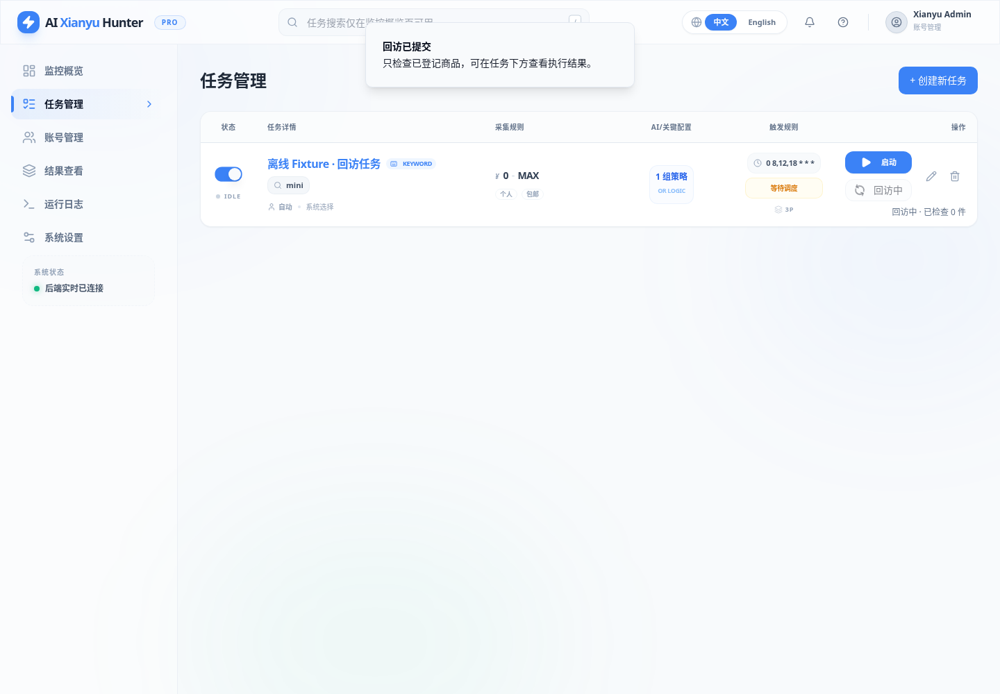
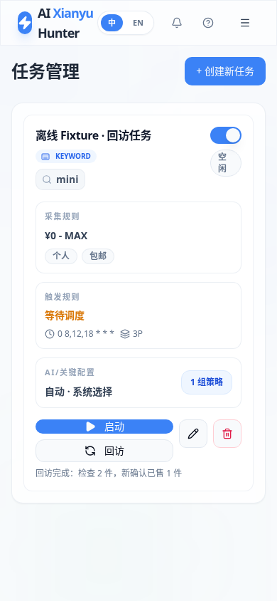

# 任务手动回访按钮

「任务管理」的“启动”下方新增“回访”，桌面和手机端均可使用。

## 使用方法

1. 保持任务总开关启用；如果尚未采集过商品，先点“启动”保存结果。
2. 点“回访”，立即检查这个任务已保存的商品，不必等次日或下一个定时时刻。未开启自动回访的任务也可以手动检查，按钮不会替你开启自动回访。
3. 按钮变为“回访中”，下方显示已检查数量。完成后显示检查数量和新确认已售数量；刷新页面可读取保存的运行状态和结果。
4. 没有可检查商品时提示先采集或检查商品是否已售、超期，不打开浏览器；登录失效或访问受限会显示相应提示。更新登录态后可再手动检查。

手动与自动回访共用任务配置的单次数量上限（默认20件，最大100件），只检查已登记商品链接，不重新搜索、不枚举全部卖家商品、不调用AI或发送逐商品通知。已售和追踪超期商品不再常规检查。同一任务正在回访时不能重复启动，手动与自动之间也互斥。

手动批次优先检查尚未检查过、或上次检查较早的记录。提前手动检查在售商品不会推迟原有未来自动计划，也不会让自动首次回访提前到登记当天；明确确认已售后停止后续常规回访。自动回访未启用或任务已停用时，结果卡片不再显示一个不会自动执行的“下次回访时间”。

按钮通过后台任务运行，页面无需一直等待长请求。运行记录、逐商品检查和价格状态仍保存在SQLite。应用关闭时取消自己管理的手动任务并释放锁；异常退出遗留的租约到期后可重新点击回访。停用任务会停止其后续商品检查，不删除已有观察。

## API与权限

新增`POST /api/tasks/{task_id}/revisits/run`，成功返回202及run_id；任务不存在返回404，任务停用返回400，已有回访运行返回409。任务列表/详情包含最近一次`revisit_run`，供进度和刷新恢复使用。

写操作沿用服务端认证和跨站检查：认证模式未登录返回401，跨站写入返回403。家庭免登录配置仍按原显式设置工作。

## 部署和回滚

分支为`feat/manual-task-revisits`，合并后可用master。没有数据库结构迁移，不重写已有配置、账号或数据。先核对实际服务器Compose和挂载、保留受限备份，再同步源码；对于已使用本Fork家庭源码Compose的部署，本地Codex可执行：

```bash
cd /home/o0521/ai-goofish-monitor
docker compose --env-file .env --env-file .lan/gateway.env \
  -f compose.sentinel.lan.yaml build app
docker compose --env-file .env --env-file .lan/gateway.env \
  -f compose.sentinel.lan.yaml up -d --no-build app
```

实际使用独立`compose.local.yaml`时先比对配置，不叠加Compose。失败时恢复旧源码/镜像和实际Compose，不默认覆盖当前数据库或删除数据卷。原有网关、LAN绑定和免登录设置不变。

本次只在Cloud开发验证，没有连接家庭服务器、真实抓取、调用AI或发送通知。真实卖家页面契约和家庭设备上的完整回访仍需部署后低频核验。

## Cloud测试记录

2026-10-30在Cloud执行：

```bash
RUN_LAN_DOCKER_TESTS=1 SENTINEL_BROWSER_TESTS=1 SENTINEL_DOCKER_TESTS=1 \
SENTINEL_CAPTURE_SCREENSHOTS=1 python -m pytest -m 'not live and not live_slow' -q
npm --prefix web-ui run test:schedule
npm --prefix web-ui run test:market
npm --prefix web-ui run build
```

- 完整回归：**255 passed，3 deselected，39.83秒**。3项真实外部采集测试未执行。
- 新增6项手动服务测试，验证次日前可检查、自动开关不被开启、数量上限、未来计划不推迟、批次轮换、空队列不打开浏览器、手动/自动互斥及未开始工作时退出也能释放锁；另有2项API测试验证202后台执行、持久化结果和404/400/409/401/403处理。
- 前端10项时间/回访状态测试、2项原图表测试及TypeScript/Vite构建通过。租约过期显示中断，空队列和访问受限显示可操作的中文提示。
- Chromium验证桌面按钮位于“启动”下方、手机按钮可见、提交时禁用重复点击、进度与完成数量、刷新恢复及无横向溢出。按钮请求被离线Fixture拦截；后台实际执行由独立API/服务测试验证。
- Fork本地源码Docker构建、源码哈希、非root浏览器、认证/网关与重启持久化回归通过。容器内实际调用手动空队列API返回202，随后保存empty结果且不打开浏览器、不启动自动回访。最终测试镜像ID为`sha256:37f39e4595b6d569ecec0e5345b91bb99063d498d91b70c88edf5a7b7449339e`。
- `git diff --check`通过；提交无真实凭据、Cookie或运行数据库。只定向清理本任务旧Cloud构建镜像和缓存，没有执行全局清理。

本次没有真实平台采集或家庭服务器验证，不宣称已上线。以下截图使用离线Fixture，演示计数不是生产样本。




