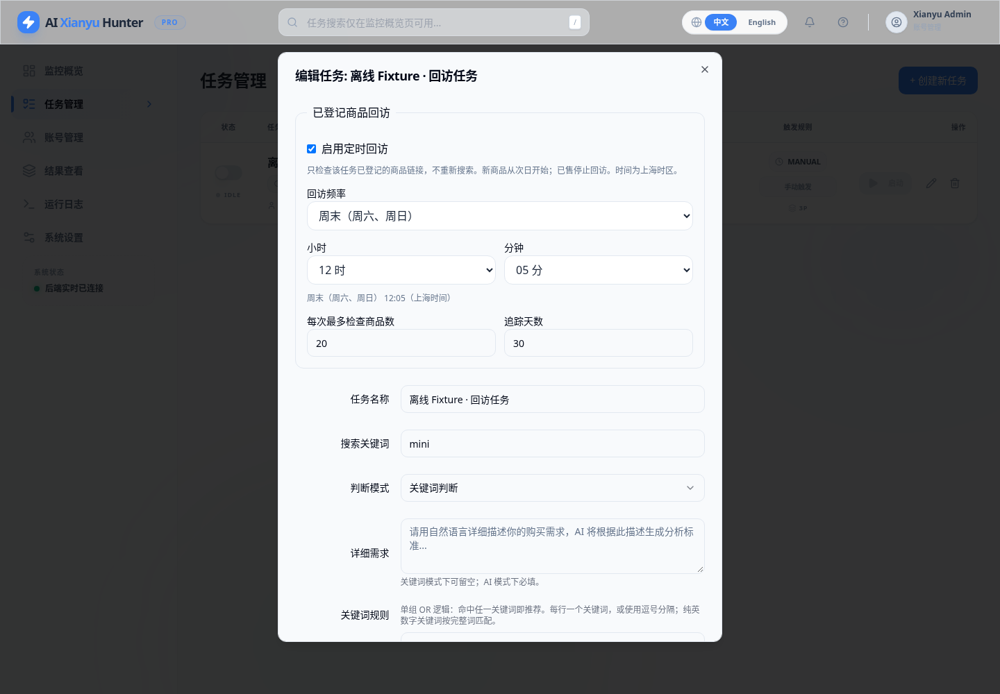
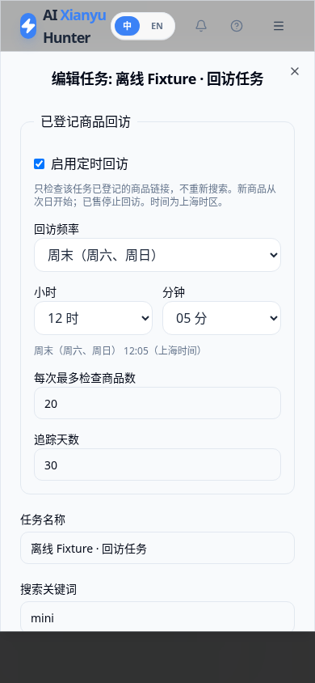

# 简化价格推送与回访时间设置

## 价格摘要

价格摘要保留任务名称作为标题，正文仅包含以下四项，不再套用商品推荐模板：

```text
价格摘要 · 任务名称

当前均价：¥5200.00
历史均价：¥5300.00
已售出均价：¥4500.00
售出最低价：¥4000.00
```

以上数字仅为离线测试示例。正式推送不附加手机端链接、电脑端链接、商品图片、“新推荐”、“价格 N/A”、原因前缀、样本数量或排除数量。企业微信、Telegram、Bark、Ntfy、Gotify、PushPlus及Webhook变量统一使用摘要内容；原异常提醒等非摘要通知保留原流程。

当前/历史均价沿用结果页默认统计口径；已售出均价、售出最低价来自该关键词中明确确认已售商品的**商品页展示价格**，不是实际成交金额，不使用最后挂牌价兜底。无有效价格显示“暂无有效样本”，不会填0；全部没有有效在售/已售样本时不发送空摘要。仍按成功采集运行发送，同一运行最多尝试一次，不新增逐商品通知或额外推送时刻。

## 回访时间

在任务的「已登记商品回访」区域直接选择：

- 回访频率：每天、每周一至每周日，或周末（周六和周日）。
- 小时：00～23时。
- 分钟：00～59分。

选择后会显示易读的结果，例如“周末（周六、周日）12:05（上海时间）”。不再要求填写或理解Cron。每次最多检查数量、追踪天数、次日起回访和原有数量限制不变。

现有每天12:00的配置会回显为每天／12时／00分，不会重置到默认09:30。后台仍使用原时间字段，无数据库迁移；星期使用明确名称，避免不同Cron实现对星期数字的解释差异。周末实际只在周六和周日触发。

对于不能用单个日期和时分表达的旧规则，例如一天多次或复杂日期，页面显示“保留现有时间规则”。直接保存其他设置不会改变旧规则；需要替换时，显式选择新的频率和时分即可。

## 部署与回滚

这是PR #4合并后的后续更新，分支为`feat/simple-schedule-price-notices`。本次只在Cloud修改、测试，不连接或修改家庭服务器，不发送真实通知。

核对实际部署Compose及原有挂载、保留配置和备份后，在已使用家庭源码Compose的Ubuntu服务器上更新到本PR源码（合并后可用master），由本地Codex执行：

```bash
cd /home/o0521/ai-goofish-monitor
docker compose --env-file .env --env-file .lan/gateway.env \
  -f compose.sentinel.lan.yaml build app
docker compose --env-file .env --env-file .lan/gateway.env \
  -f compose.sentinel.lan.yaml up -d --no-build app
```

不重写`.env`、通知渠道配置或数据库，不更改网关免登录设置。服务器若使用独立`compose.local.yaml`，先对照实际配置，不能直接叠加文件。具体备份、升级和回滚步骤沿用[商品回访部署说明](结果商品回访与已售价格分布.md)。失败时恢复旧源码/镜像与实际Compose，不用旧数据库覆盖当前数据。

## 实际测试

2026-10-30在Cloud执行：

```bash
RUN_LAN_DOCKER_TESTS=1 SENTINEL_BROWSER_TESTS=1 SENTINEL_DOCKER_TESTS=1 \
SENTINEL_CAPTURE_SCREENSHOTS=1 python -m pytest -m 'not live and not live_slow' -q
npm --prefix web-ui run test:schedule
npm --prefix web-ui run test:market
npm --prefix web-ui run build
```

- 完整回归：**239 passed，3 deselected，37.41秒**。3项真实外部采集测试未执行。
- 新增7个通知渠道的模拟请求验证：四项指标存在，摘要没有新推荐、价格N/A、原因前缀或商品链接；Bark不附加点击URL，Telegram关闭链接预览。统计测试验证已售均价4500、最低价4000来自测试商品页展示价，缺少展示价不使用旧挂牌价补齐，并保留运行去重。
- 前端6项时间选择测试、2项原图表测试及TypeScript/Vite构建通过。后端实际触发器验证周末只在周六、周日运行。
- Chromium验证旧每日规则回显、周末12:05选择、实际提交与重新打开回显、旧复杂规则原样保存和移动端无横向溢出。截图均为离线Fixture。
- Fork本地源码Docker构建及真实容器检查通过，测试镜像ID为`sha256:37feaf60345de960b0cf0d46fa4653ff2705fc77715d462eca036e494427aea1`。原认证、家庭网关免登录、非root Chromium与重启数据持久化回归通过。
- `git diff --check`通过。无数据库结构变更，未提交真实Cookie、凭据或运行数据库。只定向清理了本任务旧Cloud测试镜像/缓存，没有执行全局Docker清理。

通知测试全部拦截HTTP请求，未发送真实消息。未连接家庭服务器；真实消息客户端显示和服务器升级尚未执行，不标记为已上线。




