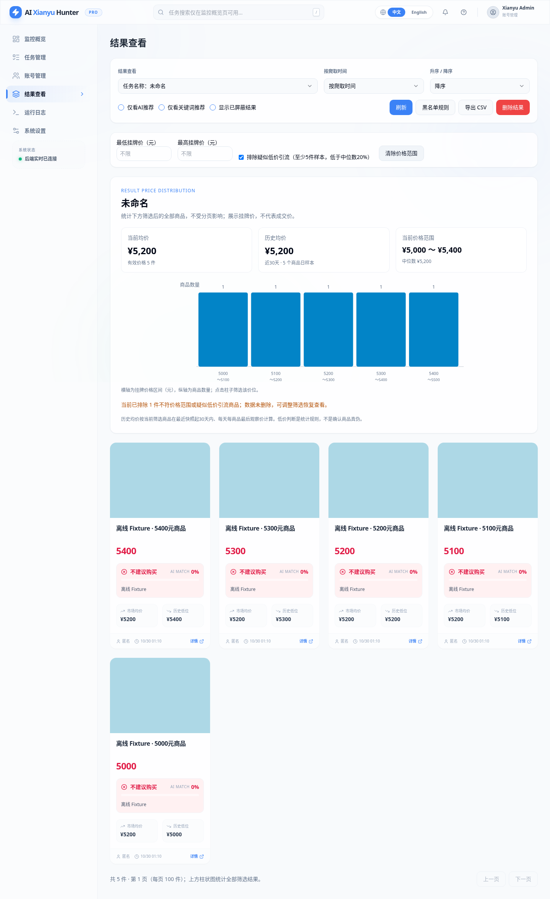
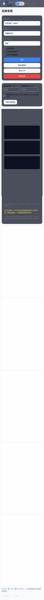

# 结果价格分布、均价摘要与家庭 LAN 免登录

按本次反馈精简了 PR #2（该 PR 已合并，因此用后续 PR 交付）。没有连接 `192.168.9.202` 或修改家庭服务器，也没有真实抓取、调用 LLM 或发送通知。

## 页面和采集

- 移除侧边栏和独立的「市场行情」页面，旧 `/market` 地址重定向到 `/results`。
- 升级后不再启动独立市场发现/卖家回访调度器，不恢复那些到期计划。旧 market_* 数据和兼容查询 API 保留，不删除账号、商品或价格历史。原有 AI/关键词任务仍按原配置运行。
- 「结果查看」改用价格区间柱状图：横轴是元为单位的挂牌价区间，纵轴为商品数。悬停查看区间/数量，点击柱子筛选该价位。
- 图表、当前均价、每张商品卡的市场均价及 CSV 使用一致的筛选逻辑，统计全部筛选结果而非仅当前分页。分页控件用于查看其余商品。
- AI/关键词推荐筛选、手动屏蔽、黑名单和显示隐藏商品仍生效；筛选变化会同步更新图表，不沿用之前任务或之前请求的均价。

## 低价引流与样本含义

默认勾选「排除疑似低价引流」：至少有5件有效价格样本时，排除低于样本中位数20%的商品。例如 25、5000、5100、5200、5300、5400 元的样本中，会排除25元，剩余5件当前均价为5200元。

这只是透明且可关闭的异常规则，不能证明商品真伪，也无法识别所有广告。少于5件时不据此自动判断；可以直接填写最低/最高挂牌价。所有排除只作用于当前展示和统计，不删除数据，取消勾选或清除价格范围即可恢复。仍然不能仅凭标题关键词断言不同芯片/配置相同；没有再把关键词命中当成独立的可靠市场分类。

- **当前均价**：筛选后商品记录中的有效挂牌价格算术均值。按商品 ID（或可用链接）去重，没有身份的旧记录独立保留；无效/非正/NaN/Infinity 价格不进入统计。
- **历史均价**：当前筛选商品在最近快照往前30天内，每商品每天最后一次有效挂牌观察的均值。同一天重复抓取不重复加权。历史样本也经过同一价格范围与低价阈值过滤。
- 没有样本显示空值，不补0，不用当前价假装历史价。以上均为挂牌观察价，不是实际成交价格。

## 推送

取消逐件推荐商品通知，原分析结果仍写入结果页。每次成功采集并完成结果保存后，发送一份「价格摘要」，包含当前均价、历史均价、已售出均价和售出最低价，不带商品链接（见[更新后的推送说明](简化价格推送与回访时间设置.md)）；没有有效价格不编造摘要。

摘要使用该任务未屏蔽的全部结果及默认低价过滤规则，不跟随某一浏览器临时的“只看AI推荐”、手动价格范围等筛选。页面恢复默认筛选后可对照。企业微信等通知渠道仍复用原配置；账号失效等原有异常提醒保留。每次运行使用独立 UUID，SQLite 元数据去重，同一运行最多尝试一份价格摘要；进程在发送中退出可能漏发，不会逐件刷屏。

## 免登录策略

`compose.sentinel.lan.yaml` 作为独立的家庭 LAN 配置：

- app 从本 Fork 源码构建，不发布宿主机端口；gateway 仍只发布 `192.168.9.202:8000`（或现有网关 env 中的指定 LAN IP/端口）。不绑定0.0.0.0、不设置公网转发。
- gateway 改挂载 `deploy/lan/Caddyfile.home`，使用显式 HTTP 反代所有路径，不要求 Basic Auth。
- app 默认 `WEB_AUTH_ENABLED=false`，页面、API 和 WebSocket 不要求应用密码或会话，首次打开/刷新不再进登录页。
- 同一局域网中能访问该地址的设备都能操作应用、任务和配置。仍保留跨站写入/跨站 WebSocket 检查。
- 普通 Python 运行和回环 `compose.sentinel.yaml` 的应用认证默认仍开启；只有家庭配置显式关闭。原有受保护的 `compose.lan.yaml` / Caddyfile 未改写，旧网关凭据文件也不删除。

如果 `.env` 已显式配置 WEB_AUTH_ENABLED=true，优先使用其值。需要免登录就在原 `.env` 中将该项设为 false，其他用户名、密码、模型、通知配置不动。需要恢复应用登录时改回 true 并配置至少12位的非默认 WEB_PASSWORD，然后重新创建 app 容器。

## Ubuntu24 升级操作（供本地 Codex 执行）

先根据运行容器标签核对真实部署目录、Compose 文件、九项挂载、镜像与其他容器状态；服务器可能运行独立 compose.local.yaml，不能假设仓库默认文件就是实际部署配置。暂停原定时任务，再只停止本项目应用并用 `scripts/sentinel_backup.py` 创建0600数据库备份，保留旧镜像和真实 Compose。不能清空数据库、覆盖 .env 或执行全局 Docker 清理。

将审查后的 `feat/results-price-summary` 源码取到项目目录；如 Git 报告本地修改冲突，保留修改后人工合并，不强制覆盖。在现有 `.env` 设置 `WEB_AUTH_ENABLED=false`，保留 `.lan/gateway.env` 中的指定 IP/端口等原参数，执行：

```bash
cd /home/o0521/ai-goofish-monitor
# 前提：源码已更新、任务已暂停、受限备份完成，现有配置与挂载已核对。
docker compose --env-file .env --env-file .lan/gateway.env \
  -f compose.sentinel.lan.yaml build app
docker compose --env-file .env --env-file .lan/gateway.env \
  -f compose.sentinel.lan.yaml up -d --no-build --force-recreate app gateway
docker compose --env-file .env --env-file .lan/gateway.env \
  -f compose.sentinel.lan.yaml ps
```

必须重新创建 gateway，单独 restart app 无法取消旧 Basic Auth。不要把此文件与其他 Compose 叠加。没有旧 `.lan/gateway.env` 时可只使用 `--env-file .env`，但先核对本机确实拥有指定 IP、端口没有被其他项目占用，不能自动改端口或停其他服务。

从另一台家庭 LAN 设备打开 `http://192.168.9.202:8000/results`，应直接显示结果页，不弹网关认证、不出现应用登录页；核对价格筛选/CSV/摘要，确认其他容器保持原状。若失败，用旧源码、镜像和真实 Compose 恢复，默认保留当前数据库，不从旧备份覆盖数据。MIT License 与原版权保留。

## 实际 Cloud 测试

2026-10-30，在 Cloud 中执行：

```bash
RUN_LAN_DOCKER_TESTS=1 SENTINEL_BROWSER_TESTS=1 SENTINEL_DOCKER_TESTS=1 \
SENTINEL_CAPTURE_SCREENSHOTS=1 python -m pytest -m 'not live and not live_slow' -q
npm --prefix web-ui run test:market
npm --prefix web-ui run build
```

- Python：203 passed，3 deselected（真实外部采集测试），32.59秒。包含旧功能回归、均价/柱状图/CSV一致性、低价过滤恢复、通知去重、认证/跨站请求和真实 Chromium 浏览器检查。
- 前端：2项图表测试通过，TypeScript/Vite 构建通过。桌面、移动端深色模式、点击价格柱筛选、刷新免登录均通过。
- 本地源码 Docker 镜像构建通过，实际测试镜像 ID 为 `sha256:3a38f88880c6ee79fb94685bf55e97a079482fee309ede532641bb2c913a56bb`。容器内源码哈希与本次源码一致，非 root UID1000、Chromium、数据库/会话重启持久化通过；隔离网络中的 Caddy→app 无 Cookie 请求返回200，家庭模式 session 明确返回 `authentication_required=false`。
- Compose 展开检查通过：只有 gateway 发布指定 LAN IP 的8000端口，app 无宿主端口，九项挂载保留。旧受保护网关配置及其401认证测试继续通过。
- 首轮容器浏览器检查因 Cloud 构建磁盘满而失败（ENOSPC）；只删除本任务已替代的旧镜像与对应缓存后，重跑以上完整测试全部通过，未执行全局清理。

未验证家庭服务器的实际升级、其他 LAN 设备访问、真实平台采集和真实通知发送；本次未连接家庭服务器，不标记为已上线。所有截图使用明确标注的离线 Fixture，不包含真实商品或账号。




