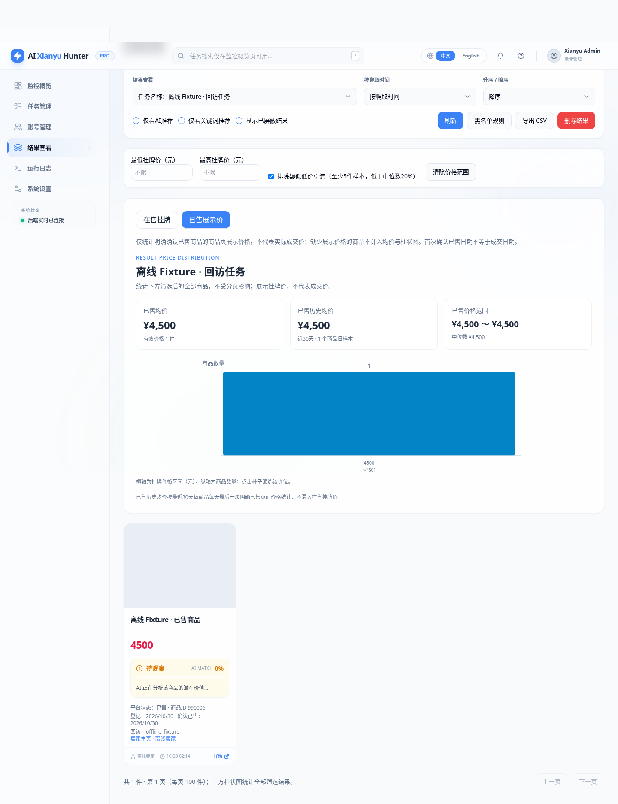
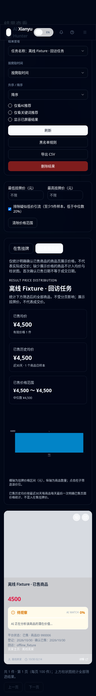
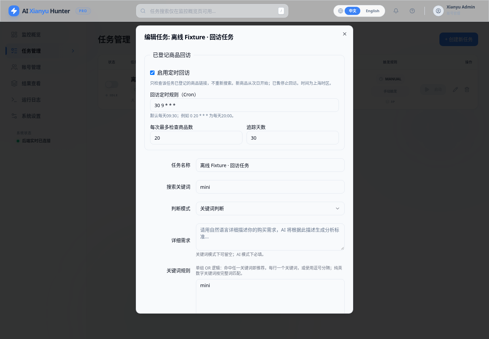

# 已登记商品回访与已售价格分布

本次扩展现有任务和结果页，不恢复独立的市场行情页面或原 market_tracking 自动采集。家庭 LAN 免登录设置保持现状。本次只在 Cloud 开发、使用离线 Fixture 测试，没有连接家庭服务器、真实采集、调用 AI 或发送通知。

## 使用

1. 在「任务管理」创建或编辑原有 AI/关键词任务，勾选「启用定时回访」。普通搜索定时规则与回访定时规则独立。回访现在直接选择每天/星期/周末及小时、分钟，详见[简化时间设置](简化价格推送与回访时间设置.md)。
2. 回访默认每天09:30（`30 9 * * *`，Asia/Shanghai）、每次最多20件、追踪30天。最多检查数量限制为1～100件，追踪天数限制为1～365天。关闭回访或禁用任务即可停止后续检查，不删除历史。
3. 开启时登记该关键词已有保存结果，此后新结果入库时自动登记商品ID、可用的卖家ID/昵称、商品链接、首次观察日期。无卖家ID时保留空值，昵称不作为身份标识。不因开关设置立即访问平台。新登记商品最早从次日对应规则时刻开始回访；旧数据保留其原首次观察日期，追踪期限从登记时计算。
4. 定时触发后只检查到期、未售、未超期的已登记商品，不执行搜索，不枚举全部卖家商品。超出单次数量上限的记录保留在队列，等待后续规则触发。多任务共享商品ID，只保留一份商品档案。
5. 在「结果查看」的原价格分析面板切换「在售挂牌」「已售展示价」，同时切换均价、历史均价、价格范围、柱状图和下方商品；价格范围、推荐筛选、黑名单、CSV保持一致。点击柱子可继续筛选。卡片显示登记日期、确认已售日期、回访结果和可用的卖家主页链接；面板可展开最近5次回访运行结果。

## 判定证据与请求上限

一次回访最多读取N个已登记商品详情页，以及至多N个卖家的公开列表首个响应页。同一卖家在一次运行中只读取一次列表，不滚动加载更多页面、不采集信用/评价。请求顺序执行，沿用至少5秒的页面间隔，每个商品检查有60秒超时，未命中的商品等下一轮再检查。

- 按商品ID在卖家列表中找到明确 `itemStatus=0/1`（复用原列表适配器的在售/已售映射），才更新对应状态。原始状态、来源、采集时间、成功标志和状态变化事件保留在 SQLite。
- 详情响应必须匹配登记的 `itemId`；详情页的数字状态码不直接用于已售判定，避免把不同接口的状态字典混用。
- 商品消失、列表首屏未包含目标、未知状态、超时、契约变化都只记录未确认，不自动判定已售。失败不删除队列。保留上一次状态和有效价格。
- 发现登录失效或访问受限时暂停该任务的回访，保留普通搜索设置；页面最近运行结果提示暂停。修复登录态后手动重新启用回访。不绕过验证码或平台限制。
- 已售停止常规回访；程序重启保留队列，下一次定时触发继续。SQLite事务、每商品锁和每任务运行租约防止并发重复；进程异常退出后两分钟租约过期可恢复。单实例调度设置防止同一规则重叠，运行记录保留已完成数量。

**真实平台适配尚未线上验证**：离线 Fixture 验证了卖家 `cardList/cardData.itemStatus`、详情 `data.itemDO.itemId/price/soldPrice` 和 `sellerDO.sellerId/nick` 的契约；平台当前字段、首屏是否包含已售商品、详情是否仍展示价格需本地授权账号低频检查。若首屏未找到目标，保守地保持未确认，可能无法识别一部分已售商品。不会为提高命中率无限翻页。适配集中在 `src/services/market_platform.py`。

## 统计定义

- 在售视图是未明确确认已售的搜索挂牌，包括尚未回访确认的记录。回访确认在售且读取到新价格后，当前价格使用最新观察值；历史均价合并原价格快照和在售回访观察，每商品每日最后一次有效价格，不重复加权。
- 已售当前均价/柱状图只使用**明确已售商品的详情页展示价格**，金额以整数分入库。不使用最后挂牌价兜底，没有展示价则为空，不计入均价和柱状图，页面显示缺失数量；商品明细仍保留。
- 已售历史均价只使用最近已售观察起30天内、每商品每天最后一次明确已售页面价格；不混入在售快照。每个商品只计一件当前样本，同一商品重复观察不产生新档案。
- 已售页展示价不等于实际成交金额；首次观察已售日期不等于真实成交日期。不声称采集到真实成交价。
- 搜索结果被原逻辑标为过期不会让已售档案消失；手动屏蔽、黑名单仍适用，勾选显示隐藏结果可恢复查看。删除有回访登记的任务会停止其队列并保留结果/价格历史。显式删除结果文件仍遵循原结果删除行为。

## 数据与升级

增量创建 `result_listing_items`、`result_listing_memberships`、`result_listing_observations`、`result_listing_events`、`result_revisit_runs`；普通 tasks 表新增4个带默认值的回访字段。默认关闭，现有任务不会自行访问平台。原 `market_*`、`price_snapshots`、账号、通知、提示词和 AI/关键词流程保留，不 DROP 旧表，不重置已有数据。

先在 Ubuntu 上核对实际 Compose 文件和九项挂载，暂停任务、停止本项目 app 后创建受限备份。可用原 `scripts/sentinel_backup.py` 备份 SQLite，同时保留 `.env`、state、config、prompts 和实际 Compose。不要假设默认 Compose 就是服务器的 compose.local.yaml，不执行全局 Docker 清理。

源码更新到本 PR 的 `feat/result-sold-revisits`（合并后可用 master）、备份与挂载核对完成后，本地 Codex 可执行：

```bash
cd /home/o0521/ai-goofish-monitor
docker compose --env-file .env --env-file .lan/gateway.env \
  -f compose.sentinel.lan.yaml build app
docker compose --env-file .env --env-file .lan/gateway.env \
  -f compose.sentinel.lan.yaml up -d --no-build app
docker compose --env-file .env --env-file .lan/gateway.env \
  -f compose.sentinel.lan.yaml ps
```

仅在当前已采用该独立家庭 Compose 时使用以上命令，不叠加其他 Compose；若实际配置不同，先比对并保留原挂载和网关设置。本次不更改网关文件。先在页面确认旧结果、任务和登录态均保留，再为需要的任务开启回访。不要直接在生产启动真实抓取以验证离线测试。

回滚：停止本项目 app，恢复旧源码、旧镜像和实际 Compose 后启动；新增表与字段可以保留，旧版本忽略这些字段。不默认用备份覆盖当前数据库，不删除数据卷。家中服务器未部署，不能标记为已上线。

## Cloud 实际测试记录

2026-10-30 在 Cloud 执行：

```bash
RUN_LAN_DOCKER_TESTS=1 SENTINEL_BROWSER_TESTS=1 SENTINEL_DOCKER_TESTS=1 \
SENTINEL_CAPTURE_SCREENSHOTS=1 python -m pytest -m 'not live and not live_slow' -q
npm --prefix web-ui run test:market
npm --prefix web-ui run build
```

- 完整回归：**230 passed，3 deselected，35.84秒**。3项真实外部采集测试未执行，没有用跳过离线测试来获取通过。
- 新增25项回访专项测试，覆盖登记去重、卖家昵称变化、多任务共享、次日计划、单次上限、失败重试、并发锁、崩溃恢复、已售展示价及缺失值、未知/失败不误判、详情状态不混用、同卖家列表缓存、首屏分页上限、原任务/快照增量升级及重复升级、删除历史保留和任务ID不复用；另有新增任务及结果 API 测试。
- 真实 Chromium：结果面板切换、图表筛选、卖家链接、任务编辑字段、免登录刷新、移动端无横向溢出通过。深色模式新增明确的价格文字颜色断言，修正了价格面板的暗底文字对比度。浏览器 Fixture 禁用实际任务，仅写入本地测试数据。
- 前端2项图表测试及 TypeScript/Vite 构建通过。
- Docker 从本地 Fork 源码构建成功，最终测试镜像为 `sha256:32089e0094e42761bfac3fe0be119e704c78595d4e3b2ebb9f04860f63002cbb`。容器源码哈希核对通过；非root Chromium、原认证及家庭免登录网关检查通过；真实重启后新回访队列、卖家ID、任务上限、原行情数据和应用会话保留。Compose仍只有网关发布指定LAN端口。
- 首轮容器浏览器检查受 Cloud 磁盘不足影响失败；定向清理本任务已替代的镜像及其旧前端缓存后，完整重跑通过。未执行全局清理。
- `git diff --check`通过；提交审计不包含运行数据库、Cookie、真实凭据、`.env`或账号文件，MIT及原版权未改写。

家庭服务器迁移、实际LAN设备访问、真实平台当前页面结构、真实账号登录态与真实通知未验证。本次不宣称已上线。以下截图来自明确标注的离线 Fixture，不是真实平台数据。






