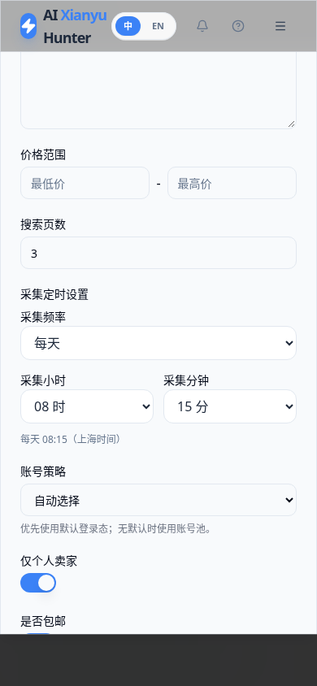
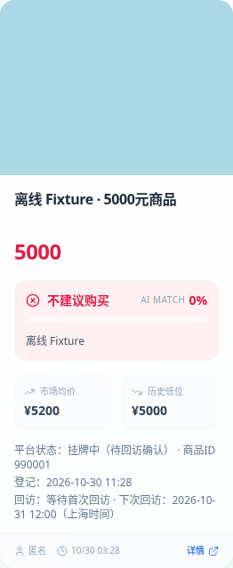
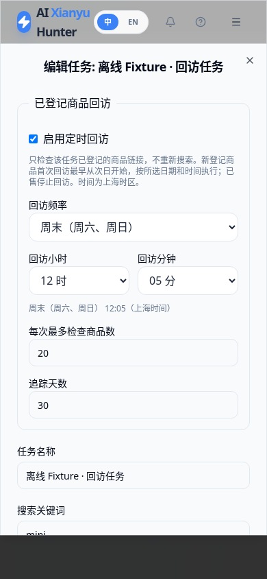

# 采集回访时间统一与下次回访说明

## 这次修复

上次只替换了回访时间输入，遗漏了任务下方原有的采集时间输入。本次两处都采用日期、小时、分钟选择：

- **采集定时设置**：仅手动运行、每天、每周一至周日、周末，加小时和分钟。
- **已登记商品回访**：每天、每周一至周日、周末，加小时和分钟；回访开关仍单独控制。

两个设置互相独立。原有复杂定时规则会显示“保留现有时间规则”，保存其他设置不会替换它，不需要输入Cron。

## 为什么是10月31日

按原有约定，**新登记商品首次从次日起回访**。10月30日登记、每天12:00回访，首次应为：

```text
2026-10-31 12:00（上海时间）
```

“每天12点”是回访的执行时刻，不表示登记当天即回访。任务界面已补充此说明。

原卡片只调用了默认日期格式，导致只显示“2026/10/31”，丢掉了小时、分钟。本次登记日期、确认已售日期和下次回访都显示完整日期与时分，统一为上海时间，设备所在时区不影响显示。

## 修改规则后会更新已有计划

原实现保存新回访规则时未修改已登记商品的队列。本次修复：

- 编辑回访规则后，重新计算该任务待执行商品的计划。
- 应用启动时检查旧版本遗留的“保存的规则”和“商品计划时刻”是否一致，并在本地修正。
- 不将首次回访提前到登记当天，不重置已有正确的逾期待办，不改写已售/超期商品或正在检查的锁定记录，不修改其他任务的计划。
- 新登记记录保存最早可回访日期。旧记录因没有独立登记时刻，保守沿用原计划日期作为最早日期，避免升级时提前检查。
- 以上只更新SQLite计划，不立即抓取、不调用AI、不发送通知。实际执行仍由定时规则及单次数量上限控制，积压商品保留到后续批次。

## 数据、部署和回滚

SQLite增量添加可空字段`result_listing_memberships.review_not_before`，保留原商品、账号、价格快照和配置。升级前按原运维说明暂停任务、停止本项目app并创建受限备份，核对服务器实际Compose及挂载；不清空数据库，不覆盖`.env`或登录态。

源码分支为`fix/schedules-and-revisit-times`（合并后可使用master）。对于已经使用本Fork家庭源码Compose的部署，本地Codex在源码同步和备份完成后执行：

```bash
cd /home/o0521/ai-goofish-monitor
docker compose --env-file .env --env-file .lan/gateway.env \
  -f compose.sentinel.lan.yaml build app
docker compose --env-file .env --env-file .lan/gateway.env \
  -f compose.sentinel.lan.yaml up -d --no-build app
```

独立`compose.local.yaml`部署须先比对实际配置，不与此Compose叠加。回滚恢复旧源码、镜像和实际Compose即可，新增可空字段可保留，不默认用备份覆盖现有数据库。

本次Cloud未连接或修改家庭服务器，没有真实平台访问，不标记为已上线。

## Cloud测试

2026-10-30在Cloud执行：

```bash
RUN_LAN_DOCKER_TESTS=1 SENTINEL_BROWSER_TESTS=1 SENTINEL_DOCKER_TESTS=1 \
SENTINEL_CAPTURE_SCREENSHOTS=1 python -m pytest -m 'not live and not live_slow' -q
npm --prefix web-ui run test:schedule
npm --prefix web-ui run test:market
npm --prefix web-ui run build
```

- 完整回归：**247 passed，3 deselected，45.25秒**。3项真实外部采集测试未执行。
- 新增8项固定时钟测试：首次次日安排、修改规则同步时分、启动修复旧计划、正确逾期待办不推迟、已满足首次条件的商品使用新规则、已售/超期/运行锁保护、多任务隔离及旧表增量重复升级。
- 前端8项时间规则/完整时间格式测试、2项原图表测试和TypeScript/Vite构建通过。即使设备在洛杉矶时区，卡片仍显示上海时间12:00，不丢失时分。
- 真实Chromium验证两处时间选择、实际保存回显、复杂旧采集/回访规则保留、移动端布局，以及卡片完整日期和12:00显示。界面截图均为离线Fixture。
- 本地Fork源码Docker构建通过，最终测试镜像ID为`sha256:cdde8c17c09dd6669cd18ac9cc2bc589dc70cdf61469c5cc5f27a24b46ad04af`。源码哈希、非root Chromium、认证/家庭网关、真实容器重启数据与队列持久化回归通过。
- `git diff --check`通过，提交审计无真实Cookie、凭据、运行数据库或账号文件；MIT及原版权保留。只清理本任务已替代的Cloud构建缓存，没有执行全局清理。

没有真实抓取、AI调用、通知发送或家庭服务器升级，不宣称线上验证完成。






