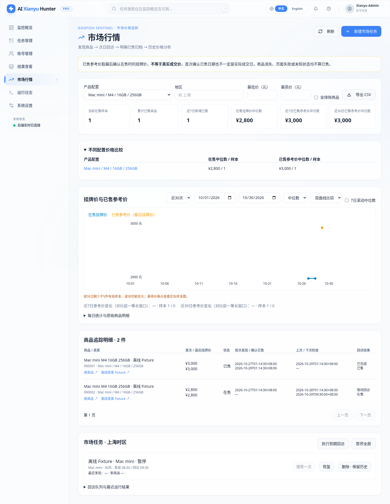
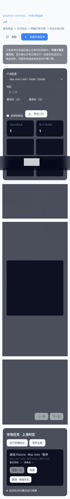

> **历史 PR #2 文档。** 当前版本已移除独立市场页面与自动回访，推送和家庭 LAN 认证策略也已调整；请以 [当前操作与部署说明](结果价格分布与家庭LAN免登录.md) 为准。以下保留作历史实现及测试记录。

# 闲鱼哨兵（Goofish Sentinel）v1.0

本 Fork 新增 `market_tracking` 独立模式。它使用现有 Python / Playwright / FastAPI / SQLite / Vue 技术栈，从发现商品、次日卖家回访、明确已售归档到价格曲线形成完整流程。原有 AI 推荐、关键词模式、账号管理与通知仍保留；普通市场追踪不调用 LLM，也不自动联系卖家、下单或支付。

**交付为代码与 Cloud 验证，不表示已部署到家庭服务器。** 线上闲鱼页面结构、真实 Cookie 有效性和服务器性能仍需本地低频验收。

## 使用

登录后进入侧边栏「市场行情」，创建市场任务，填写关键词、追踪天数和可选的 `state/` 账号文件名。无需选择 AI 模型或填写模型 API Key。默认每天上海时间 08:30 发现商品，09:30 回访，新商品从次日开始回访，追踪 30 天。可以更改两个时间和追踪期限。

- 「搜索一次」请求一次发现任务；「执行到期回访」只处理已到期商品，不提前访问次日队列。刷新或查看运行记录可看到进度及错误代码。
- 暂停、恢复和「暂停全部」使用持久化任务开关。暂停会在当前请求结束后阻止继续处理卖家；单个已开始的浏览器请求不能瞬间撤销。
- 删除任务只作归档，默认且仅支持保留长期商品、价格与状态历史，避免意外清除行情样本。
- 选择标准产品配置查看曲线，支持地区、价格区间、日期范围、均值/中位数、在售/已售双曲线和 7 日滚动已售中位数。列表和 CSV 的价格区间依据商品当前最后挂牌价/已售参考价；历史曲线按当天观察价格过滤，避免用今天的价格筛掉过去样本。
- 点击商品标题可查看价格观察历史、原始状态、采集质量和状态事件。可人工更正产品分类、恢复被规则排除的商品；更正保留操作人、前值、后值及时间。
- 商品链接、卖家链接由经过校验的数字 ID 构建，不以昵称作为身份，不接受任意外部跳转地址。
- 每日摘要复用已有企业微信等通知客户端；没有有效样本时显示「暂无有效样本」。账号失效/访问限制会立即暂停市场任务并尝试通知。连续发现失败 3 次暂停该发现任务；连续无法确认的回访计入每日摘要，不逐件刷屏。

## 数据含义：挂牌价不是实际成交价

| 字段 | 含义 |
| --- | --- |
| first_listed_price | 首次发现时有效的挂牌观察价格 |
| last_observed_price | 最近一次有效状态观察中的可见价格（可能来自已售页面） |
| last_listing_price | 最后明确在售时有效的挂牌价；缺价格的观察不覆盖已有有效值 |
| sold_display_price | 已售页面展示的价格，单独存储，不等于成交金额 |
| sold_reference_price | 首次明确已售时冻结的最后有效在售挂牌价；没有该挂牌价则为空 |
| price_source | `last_listing_price`，无可用参考价时为空 |
| actual_transaction_price | 第一版始终为空，数据库约束也禁止写入猜测金额 |
| first_seen_sold_at | 首次确认已售的上海时区时间，不一定是真实成交时间 |

数据库商品价格为整数分（fen/CNY），API 金额也以分返回；均值、中位数等统计结果可能出现分的小数，页面转换成元显示。CSV 明确给出单位与价格说明。重复已售观察只增加观察历史，不重复累计新已售商品。重新上架写新的状态事件，继续追踪，但保留第一次已售档案和首次已售参考价，不把同一商品重复视为新的成交样本。

每日在售曲线取当天每个商品最后一次有效明确状态观察，只有最后状态仍在售且有价格才入样。没有当天观察不延续旧价格，不插值、不补零。已售曲线按 `first_seen_sold_at` 的日期归档；已售总数包含没有可用参考价的明确已售商品，价格样本数只包含有参考价者，两者都可从 API 读取。当前在售概览不包括已结束常规追踪的 expired 计划。

7/30 日变化是最近 7/30 个自然日中位数与前一等长窗口的差值和百分比，缺少任一窗口样本则为空。滚动 7 日中位数对真实商品样本计算，不是对每日中位数再次取中位数。少于 5 件价格样本会提示低样本量。全配置概览不代表单一配置，曲线必须选择配置；`unknown` 需要人工核对，不能据此推断型号价格。

## 状态与平台适配

状态独立于 `result_items.status`：`active` 明确在售、`sold` 明确已售、`offline` 明确不可售且无成交证据、`unknown` 尚无有效判断、`stale_unconfirmed` 长期不能确认。

`src/services/market_platform.py` 是独立的平台适配边界。复用原搜索解析、详情 `sellerDO.sellerId`、卖家主页 `userId` 及 `_parse_user_items_data()`，只读取公开商品列表，不读取卖家头像、信用、评价或无关资料。当前 Fixture 合同为 `mtop.idle.web.xyh.item.list` 的 `data.cardList[].cardData`，0=在售、1=已售。字符串形式的相同代码可解析；所有其他代码保持未知，保存原始值，不臆测下架或已售。只有未来经过证据验证的适配器明确输出 `explicit_offline` 才会写 offline。

商品缺失、账号异常、权限限制、未知状态、加载失败一律不推出已售。失败观察保留之前的明确状态和价格，写入请求、页面与列表完整性标记、来源及安全错误代码。列表未全部加载时，已实际获取的明确商品状态可作为证据；未出现的目标仍是未知，不能推出交易状态。连续 7 次不能确认或追踪期结束仍不能确认，记录 stale_unconfirmed 并结束常规回访。

分类使用可扩展正则，识别 Mac mini 芯片、明确内存/SSD组合及有限的成色/配件/保修/故障描述。规格不足或出现多组矛盾配置一律 unknown。这里只解析卖家文本，不验证机型真伪，不把示例中的 M6 推断为已存在或已发布的型号。明显空盒、求购、服务和故障默认排除，允许人工恢复。未实现可选 AI 分类接口，普通追踪完全不依赖它。

## SQLite 与执行恢复

增量增加 market_tasks、market_items、market_task_items、market_item_observations、market_status_events、market_revisit_jobs、market_runs、market_leases、market_classification_events、market_notices，及对应索引。保留所有旧表和旧数据。市场页面只统计新增追踪样本；不会把旧 price_snapshots 反推为已售或伪造 seller_id，旧历史继续在原结果页面查看。记录 `migration:market_tracking:v1` 标记，重复启动/升级不会重复导入市场记录。

- 商品主体按 item_id 唯一，多关键词通过关联表共享商品。seller_id 缺失则保留待补全，次日尝试详情补全；不使用昵称或伪造 ID。
- 观察唯一键 `(item_id, run_id, source)`；状态事件、观察与当前投影在同一 SQLite 事务内写入。保留乱序证据，但不以旧证据回退当前状态。
- APScheduler 每分钟扫描 SQLite 的 next_discovery_at 和到期队列，不用内存队列保存事实。搜索按商品提交进度，崩溃不会丢失已发现商品。
- 全市场采集共用一把 SQLite 租约，15 分钟有效、30 秒续租；队列在 `BEGIN IMMEDIATE` 内原子认领。正常异常/取消会释放未完成计划；硬退出后租约到期可由其他进程恢复。写入前再次校验拥有者，过期工作进程不能继续覆盖数据。
- 搜索临时失败 15 分钟后重试，最多连续 3 次；失败回访保留状态，按下一日回访时间重查，连续未知上限 7 次。浏览器启动失败也会写失败观察并重排，避免每分钟空转。
- 单浏览器顺序处理，请求间至少 2 秒、默认 5 秒，最多 5 个搜索页，每页最多处理 100 件商品；一批回访最多 200 件，每卖家最多 5 页。相同卖家的多个到期商品合并访问一次，不换账号绕过限制。
- 回访批次使用当前最早创建的启用市场任务所选账号读取公开卖家列表，整批共享登录上下文；不同任务指定账号的独立可见范围尚不支持。限制或登录失效时暂停全部市场任务，需人工修复并恢复，不自动轮换账号。
- 首次硬退出可能等待最多约 15 分钟租约恢复。每日通知有数据库去重记录；跨多个外部渠道无法提供严格一次交付，发送过程中进程退出可能漏发当日摘要（sending 状态不盲目重发），不影响采集数据。

## API

所有 `/api/*`（含旧业务）和 `/ws` 均由服务端验证 HttpOnly 签名会话。保持 `POST /auth/status` 原 JSON 请求/响应约定，登录成功额外设置会话 Cookie；`GET /auth/session` 校验会话、`POST /auth/logout` 清除浏览器 Cookie。密码更改使旧会话失效。Cookie 默认 Strict、HttpOnly，HTTPS 时使用 Secure；当前回环 HTTP 部署不加密传输。登录限速，跨站写入/跨站 WebSocket 拒绝。

默认弱口令不允许登录，必须设置非默认且至少 12 字符的 WEB_PASSWORD。签名密钥默认在数据库目录的 `.session_secret`（0600）自动创建并持久化，也可通过至少 32 字符的 WEB_SESSION_SECRET 指定；不把密码或 Token 写入 localStorage。前端的登录标记只作界面缓存，路由会向服务端验证，篡改缓存不能授权 API。退出清除本浏览器会话，已复制的签名 Cookie 在 12 小时过期或密码/密钥更换前仍可能有效，应保护 Cookie。

| 接口 | 用途 |
| --- | --- |
| GET/POST /api/market/tasks | 列出/创建独立市场任务 |
| PATCH/DELETE /api/market/tasks/{id} | 暂停/恢复、通知开关 / 归档任务并保留历史 |
| POST /api/market/tasks/pause-all | 暂停全部市场任务 |
| POST /api/market/tasks/{id}/run | 持久化请求一次发现，返回 202；工作器忙返回 409 |
| GET /api/market/items | 分页、配置/地区/状态/价格/任务筛选 |
| GET /api/market/items/{id} | 商品及最近观察 |
| GET /api/market/items/{id}/history | 分页观察、状态事件、人工分类审计 |
| PATCH /api/market/items/{id}/classification | 仅更正分类及排除标志，不能改价格 |
| GET /api/market/trends | start/end，最多 366 日跨度；每日样本明细及滚动统计 |
| GET /api/market/stats | 当前在售、已售、7/30 日及配置比较 |
| GET /api/market/revisits、/api/market/runs | 分页计划、最近执行结果 |
| POST /api/market/revisits/run | 请求执行到期回访，不强制提前执行 |
| GET /api/market/export | 按当前筛选导出商品档案 CSV，防公式注入 |

列表分页 `page` 从 1 开始，`limit` 上限 100；历史上限 200。价格筛选 min_price/max_price 单位为分。日期为上海自然日；完整时间格式如 `2026-10-30T09:30:00+08:00`。输入错误 422，未授权 401，跨站写入 403，不存在 404，运行冲突 409，调度不可用 503。完整字段可从本机 OpenAPI 查看；不要向公开日志导出运行配置或 Cookie。

## 界面截图

下图来自离线 Fixture，页面无生产内置假数据，示例截图不构成真实闲鱼验证。

本地回环与已有 LAN 网关分别提供独立的源码 Compose 文件，不叠加端口配置。部署、升级、备份和回滚见 [Ubuntu 部署说明](Ubuntu24-Sentinel部署.md)，实际测试见 [测试结果](Sentinel测试结果.md)。
